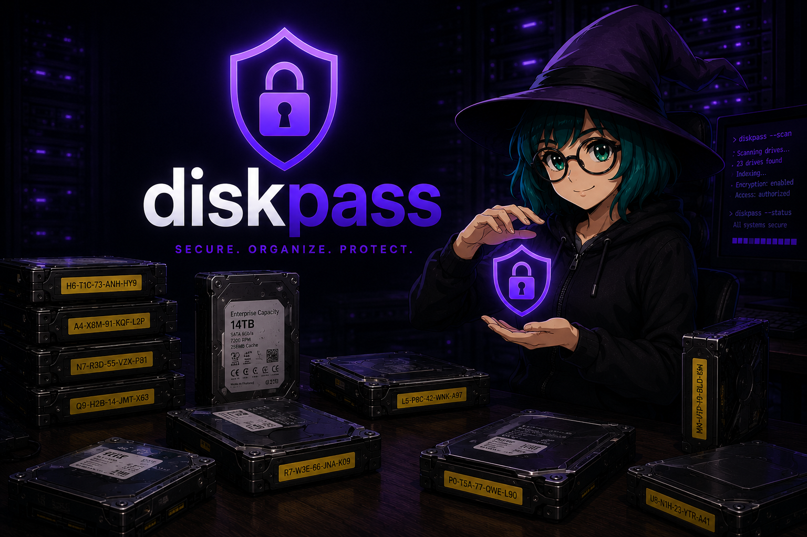
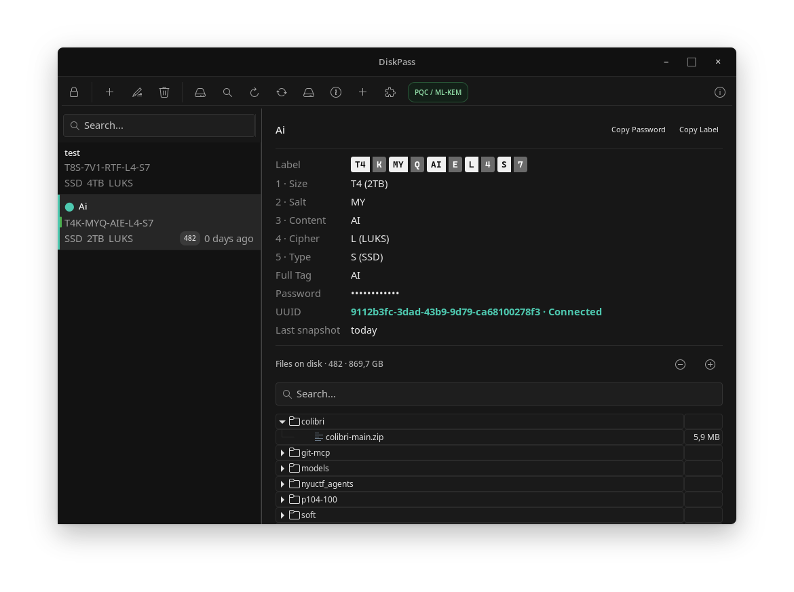
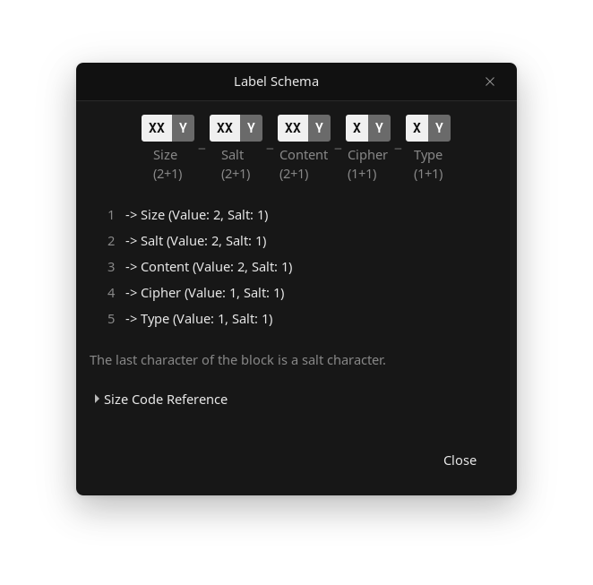

**README Language:** [Русский](README.ru.md) | **English**

# Diskpass

A generator of cryptographically secure physical tags for storage media.

Diskpass solves a specific problem: you have an archive of dozens of physical drives (HDDs, SSDs, LTO tapes, flash drives), and you need to label each one without revealing to outsiders what is stored on it, how it is encrypted, and what password protects it.

The program generates a short tag like `HK-T1R-BAM-LK-XYQ` that is attached to the drive. The owner, knowing the schema of their database, can use this tag to restore the drive type, capacity, contents, encryption method, and find the corresponding password entry in the local database. For everyone else, it's just a set of characters.

## Threat Model

Diskpass was designed under a specific threat model, and it is important to clearly define its boundaries rather than relying solely on security through obscurity.

**Considered adversary:** A passive observer with physical access to the drive and its tag (seizure, theft, accidental archive leak), but who does not possess the database's secret material — the private OpenPGP key, its password, or the `noise_key` and `salt` values. It is assumed that such an adversary can:

- Visually inspect an arbitrary number of tags on different drives in the archive;
- Attempt to identify patterns in the tag structure using frequency and structural analysis (comparing block lengths, repeating characters, position statistics);
- Have unlimited time for analysis, but no access to the encrypted database or its key material.

**Guarantees within this model:**
- Revealing the tag's semantics (drive type, capacity, encryption method, contents) is impossible without knowing the specific database schema — the permutation of the blocks itself is part of the secret and cannot be deduced from the tag's appearance.
- Structural cryptanalysis across multiple tags of the same database does not give the adversary enough information to recover the encoding dictionaries or block order: the closing character of each block is a cryptographic salt (BLAKE2b of the block value, `noise_key`, and `salt`), which makes the block statistics indistinguishable from a uniform distribution without the secret material.
- A tag without access to the database is a short-lived, self-contained artifact: outside the context of the encrypted database, it carries no computationally extractable information.

**Explicitly out of scope:**
- An active adversary who has compromised the private key and its password — with full key material, the database decrypts normally; Diskpass does not protect against the compromise of the key itself.
- Diskpass is not a tool for encrypting data on the drive — it is a metadata cataloging tool for the encryption method and parameters already applied by another tool (LUKS, VeraCrypt, BitLocker, etc.).
- Side-channel attacks, keylogging, or compromise of the workstation on which the database is decrypted are outside the application's responsibility perimeter.

In other words, the tag's resilience relies not on the secrecy of the encoding algorithm (it is open and described below), but on the cryptographic strength of the block salt and the fact that the secret material (`noise_key`, `salt`, private key) exists exclusively inside the OpenPGP-encrypted database and never leaves it in plaintext.



## Key Features

- **Physical tag generation** from 5 components: drive type, capacity, user content label, encryption method, disk salt.
- **Unique schema per database** — when initializing a new database, the order of the 5 tag components is randomly shuffled (5! = 120 variations) and fixed as part of the database secret. Knowing the format of one database does not allow interpreting tags of another.
- **Capacity list depends on drive type** — when selecting, for example, LTO5 in the add entry form, only the actual capacities for that tape generation (1.5TB/3.0TB) are offered, rather than a general list of all possible capacities.
- **Capacity code hints** — the schema dialog contains a collapsible list deciphering all two-character capacity codes so you don't have to memorize them.
- **Database encryption via OpenPGP** — the entire database (passwords, notes, tag mappings) is encrypted with a public GPG key via GPGME; only the owner of the private key can decrypt it.
- **Key password is always requested anew** — every time the database is unlocked, GPGME forcefully shows the password prompt (`pinentry-mode ask`), even if `gpg-agent` has already cached the password for other needs. This prevents unlocking the database "by inertia" without explicit password entry.
- **Secure memory handling** — passwords and secret keys are stored in protected memory (`sodium_malloc`) and reliably wiped (`sodium_memzero`) immediately after use.
- **GTK3 interface** with a native window header (`GtkHeaderBar`), works under both Xorg and Wayland without additional configuration.

## Tag Format

The tag consists of 5 blocks separated by hyphens. The order of the blocks is defined by a unique schema generated for the specific database.

Tag components:

| # | Component | Description |
|---|-----------|-------------|
| 1 | `type` | Physical drive type |
| 2 | `size` | Drive capacity |
| 3 | `content_tag` | User content label |
| 4 | `cipher` | Encryption algorithm |
| 5 | `dsalt` | Unique disk salt |

Each block has the format `[ENCODED_VALUE][SALT]`, where the last character is not part of the data, but a cryptographic block salt (see below).



### Tag Generation Algorithm

1. **Database Schema.** When creating a database, its 5 components are mixed in a random order — this sequence is fixed as a unique schema for this database.
2. **Data Encoding.** The user-entered type, capacity, and cipher are converted into short internal codes using the utility's dictionaries.
3. **Disk Salt.** A unique random salt (`dsalt`) is generated for each drive.
4. **Block Assembly.** The encoded values are arranged in the order specified by the database schema.
5. **Block Salt.** A cryptographic salt character is calculated for each block — BLAKE2b of the block value, the secret `noise_key` of the database, and the global `salt` of the database — and appended as the last character of the block.

### Example

Tag `HK-T1R-BAM-LK-XYQ` with the default schema (`type-size-content-cipher-dsalt`):

| Block | Code | Salt | Decoding |
|:-----:|:----:|:----:|:---------|
| `HK` | `H` | `K` | Drive type: **HDD** |
| `T1R` | `T1` | `R` | Capacity: **1TB** |
| `BAM` | `BA` | `M` | Content label: **Backup** (user-defined) |
| `LK` | `L` | `K` | Cipher: **LUKS** |
| `XYQ` | `XY` | `Q` | Disk salt: **XY** |

> The purpose of encoding is not to hide the very existence of an attribute (capacity, type), but to deprive the observer of reference points for structural analysis. Human-readable values (`500GB`, `HDD`) immediately reveal semantics and block boundaries; short, non-obvious codes combined with a random schema permutation eliminate this metadata leak.

## Encoding Schemes

**Drive type (`type`):** One character. Standard drives use the first letter: `H` — HDD, `S` — SSD, `U` — USB, `M` — M.2, `D` — SD, `C` — CF, `O` — OPTICAL, `X` — OTHER. LTO magnetic tape generations are encoded with digits `1`–`9` (LTO1–LTO9), and only physically existing capacities are available for each generation.

**Cipher (`cipher`):** One character: `L` — LUKS, `V` — VeraCrypt, `B` — BitLocker, `7` — 7-Zip, `A` — Age, `G` — GPG, `N` — No encryption (NONE).

## Architecture & Implementation

Diskpass is written in **C** (originally prototyped in Python, then completely rewritten for memory control and performance). It uses:

- **libsodium** — random value generation, secure memory allocation, and wiping.
- **GPGME** — OpenPGP key management and database encryption/decryption, including forced password prompting on every unlock.
- **cJSON** — database serialization.
- **GTK3** — graphical interface, including native window header and Xorg/Wayland compatibility.


## Installation

```bash
sudo apt install build-essential pkg-config libgtk-3-dev libgpgme-dev libsodium-dev libcjson-dev

git clone https://github.com/Sergei768/Diskpass/

cd Diskpass

chmod +x ./build.sh && ./build.sh
```
