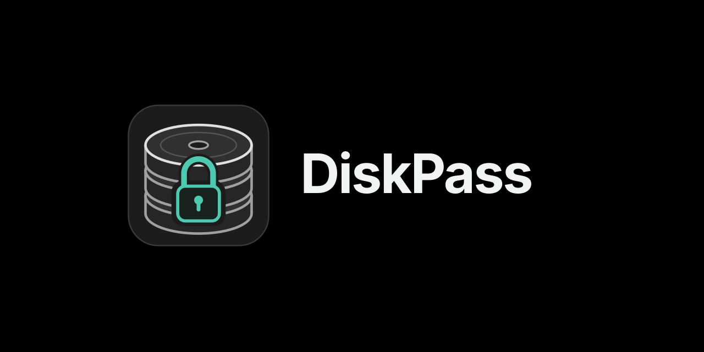
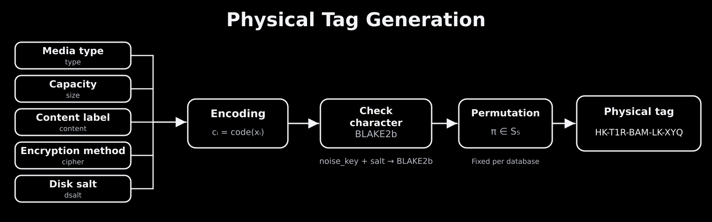
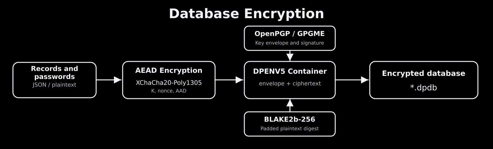
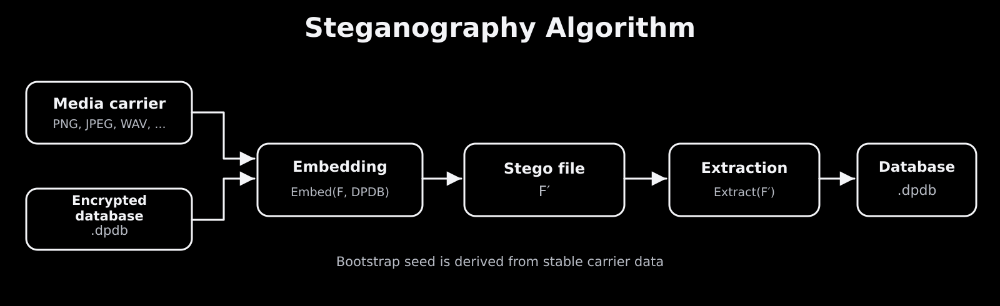

<p align="center">
  
</p>

**Documentation / Languages:** [English](../README.md) · [Русский](README.ru.md) · [Українська](README.uk.md) · [Беларуская](README.be.md) · [Қазақша](README.kk.md) · [简体中文](README.zh_CN.md) · [繁體中文（台灣）](README.zh_TW.md) · **日本語** · [한국어](README.ko.md) · [Français](README.fr.md) · [Deutsch](README.de.md) · [Español](README.es.md)

# Diskpass

物理ストレージ用の識別タグを生成し、暗号化されたローカル台帳で媒体を管理するアプリケーションです。

HDD、SSD、USB メモリ、LTO テープなどが多数ある場合、Diskpass は内容、暗号化方式、パスワードを媒体に直接記載せずに管理できます。`HK-T1R-BAM-LK-XYQ` のような短いタグを媒体に貼り付け、詳細情報は暗号化された `.dpdb` データベースから参照します。タグ自体にパスワードは含まれません。

## 主な機能

- **物理タグ：**媒体の種類、容量、内容ラベル、暗号化方式、媒体ごとのランダムソルトを符号化します。
- **データベース固有の並び順：**作成時に五つの項目をランダムに並べ替えます（`5! = 120` 通り）。
- **アーカイブ管理：**媒体の登録、パスワードやメモの保存、ディレクトリのスナップショット、未接続媒体のファイル検索、SMART 情報の保存に対応します。
- **保護された保存形式：**DPENV5、XChaCha20-Poly1305、OpenPGP/GPGME を使用し、ML-KEM の利用には対応する GnuPG が必要です。
- **追加機能：**ステガノグラフィ、自動ロック、クリップボードの消去、電卓モード、信頼済みネイティブプラグインを備えています。

## 物理タグの生成



タグはハイフンで区切られた五つのブロックで構成されます。各ブロックは **`[コード][検査文字]`** 形式で、末尾の文字は **BLAKE2b** とデータベースの `noise_key` および `salt` を使って計算します。

| 項目 | 内容 |
|---|---|
| `type` | HDD、SSD、USB、LTO などの媒体種別 |
| `size` | 容量を表す短い内部コード |
| `content_tag` | ユーザーが指定する内容ラベル |
| `cipher` | 媒体に適用した暗号化方式 |
| `dsalt` | 媒体ごとに生成するランダム値 |

**手順：**項目の順序を決定 → 値を符号化 → `dsalt` を生成 → 各ブロックの検査文字を算出 → 順序に沿って連結します。通常の並び順で `HK-T1R-BAM-LK-XYQ` は HDD、1 TB、Backup、LUKS、ソルト `XY` を表します。

## `.dpdb` データベースの暗号化



Diskpass はパスワード、タグの対応関係、メモ、スキーマのパラメータ、ファイル索引を **DPENV5 バイナリコンテナ**に保存します。

1. **シリアライズ：**`cJSON` でデータ構造を構築します。
2. **認証付き暗号化：****XChaCha20-Poly1305** で内容を保護し、外側のヘッダーを AAD に含めます。
3. **鍵エンベロープ：****OpenPGP/GPGME** で鍵情報を保護し、秘密鍵の操作は GnuPG/pinentry に委ねます。
4. **署名とハッシュ：****BLAKE2b-256** のダイジェストを使い、DPENV5 の署名をパディングされた平文に結び付けます。
5. **世代の確認：**バージョン連鎖とローカルの anti-rollback 状態により、古いデータベースの復元を検知しやすくします。

**ML-KEM/Kyber** には対応する GnuPG/OpenPGP エンジンが必要です。**Argon2id** は電卓モードの認証コードとローカル設定の保護に使用され、`.dpdb` の暗号化とは別の役割です。

## ステガノグラフィ



**暗号化済み `.dpdb`** を画像や音声ファイルに埋め込めます。抽出後に内容を開くには、引き続き OpenPGP の秘密鍵が必要です。

| メディア形式 | 埋め込み方法 |
|---|---|
| PNG、BMP、TIFF、可逆 WebP など | RGB 画素の最下位ビット（LSB） |
| JPEG | 選択した量子化 AC DCT 係数の偶奇 |
| 整数 PCM の WAV | 各サンプルの最下位ビット |
| MP3 | 既存の ID3v2 APIC カバー画像 |
| FLAC | 埋め込み済み PICTURE カバー画像 |

新しい形式では媒体の安定した情報から bootstrap-seed を計算し、データベースを開く前に暗号化コンテナの位置を特定できます。`DISKPASS_STEGO_MAX_PERCENT` は既定 **20%**、設定可能範囲は **1～40** です。

## 構成とビルド

実装言語は **C11** です。**GTK3/GLib** が GUI、**libsodium** が乱数と機密メモリ処理、**GPGME/GnuPG** が OpenPGP、**cJSON** がシリアライズ、**libjpeg/libwebp** が画像処理を担当します。ABI v1 プラグインはメニュー機能を拡張し、Katasymbol E11 では Bluetooth LE によるラベル印刷が可能です。

**Debian / Ubuntu：**

```bash
sudo apt install build-essential pkg-config libgtk-3-dev libglib2.0-dev \
  libgpgme-dev libsodium-dev libcjson-dev libjpeg-dev libwebp-dev

git clone https://github.com/Sergei768/Diskpass.git
cd Diskpass
make -j2
./diskpass
```

ユーザー環境へのインストールには `./build.sh` を通常ユーザーで実行してください（`sudo` は使わないでください）。`diskpass-package.sh` は各形式に対応するパッケージツールを必要とします。

## 脅威モデルとライセンス

想定するのは媒体とタグを観察できても、データベースの秘密情報や OpenPGP 秘密鍵を持たない受動的な第三者です。タグは**仮名化されたメタデータであり、暗号文ではありません**。同じ値やブロック長からパターンを推測できる場合があります。Diskpass は媒体内部のファイルを暗号化せず、埋め込みの検出不能性も保証しません。また、侵害された端末や秘密鍵は保護対象外です。ネイティブプラグインはサンドボックスなしで動作します。

独自コードは **BSD-3-Clause**、同梱の電卓コードは **GPL-3.0-or-later**（`calculator/COPYING`）です。
